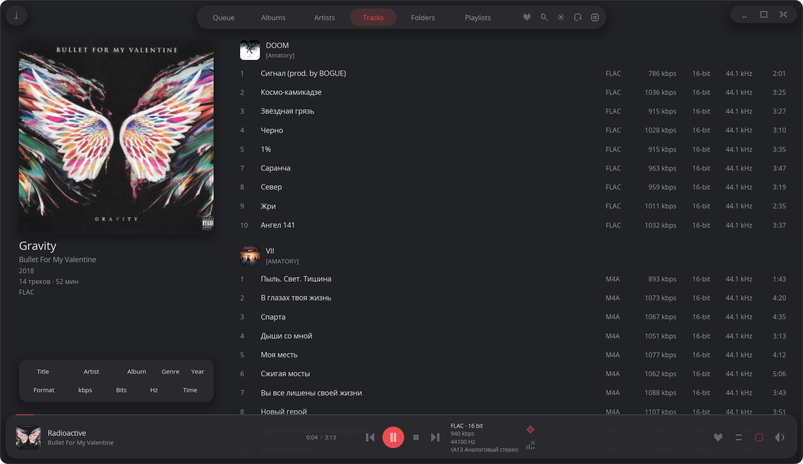
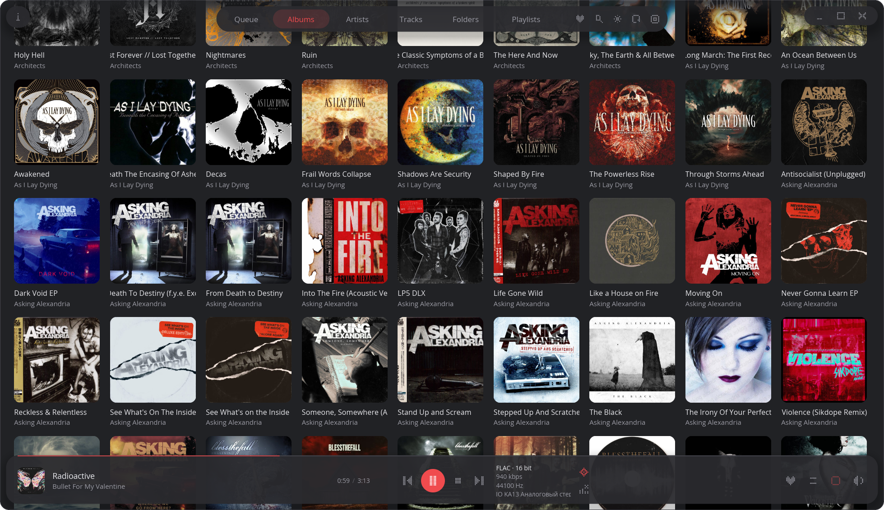
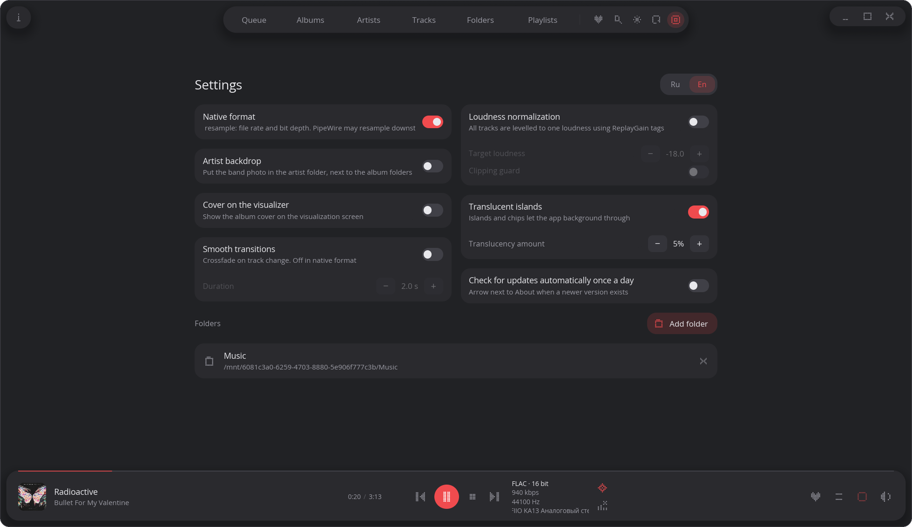
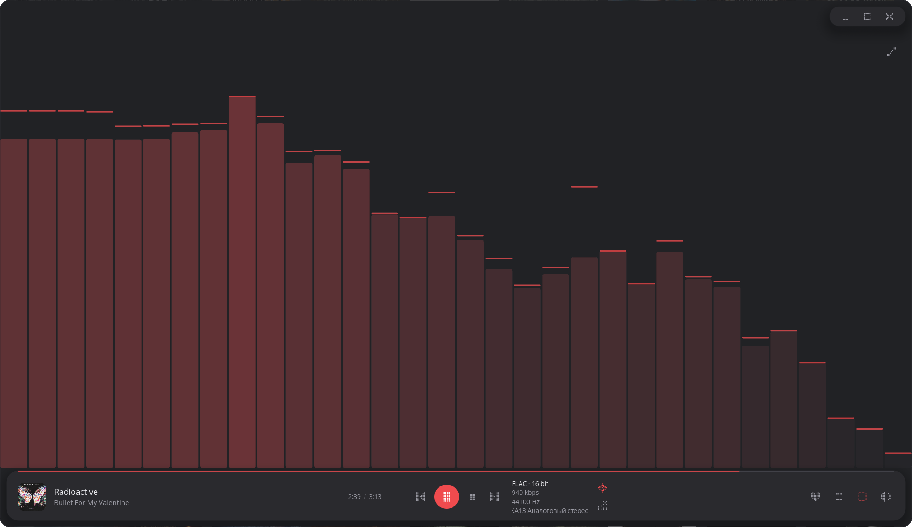
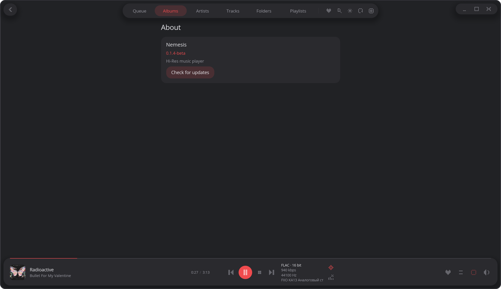
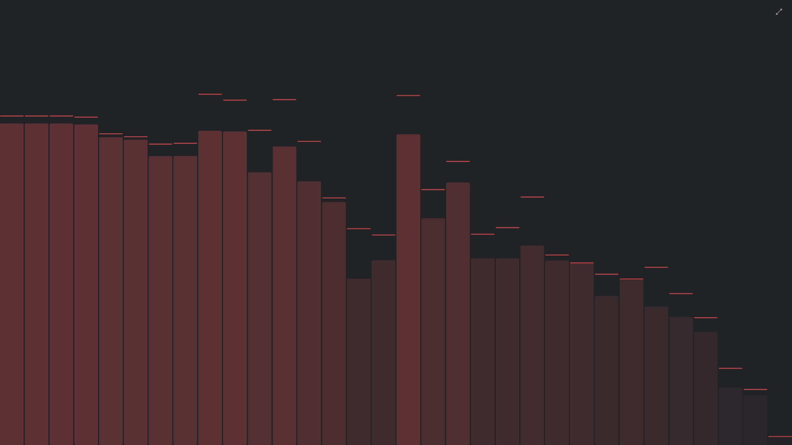

<div align="center">


# Nemesis

A local music player. Native UI on [iced](https://iced.rs/), no embedded browser.<br/>Beautiful, fast, hi-res PCM, no Electron. Windows & Linux.

<p align="center">
  <a href="https://github.com/aevahonin/Nemesis/releases/latest"></a>
  <a href="https://flathub.org/apps/io.github.aevahonin.Nemesis"></a>
  <a href="https://rust-lang.org"></a>
  <a href="#linux-and-windows"></a>
</p>

[Features](#features) · [Install](#install) · [Changelog](CHANGELOG.md) · [Issues](https://github.com/aevahonin/Nemesis/issues)

**English** · [Русский](README.ru.md)

</div>

<p align="center">
  
</p>

<details>
<summary>More screenshots</summary>

<p align="center">
  
  
  
  
  
  
</p>

</details>

---

## Features

**Library and playback**

- On-disk library: mp3, flac, wav, ogg/Vorbis, opus, m4a/aac, alac, CUE sheets, covers.
- Home page with "Continue" and "Most played" rows, a stats strip and a random album button.
- Queue, albums, artists, tracks, folders, playlists; shuffle, repeat, crossfade, gapless, seek, favorites.
- Search over title, artist and album: case-insensitive (Cyrillic included), runs of spaces collapse, and «ё» counts as «е». Enter plays the results starting from the first one.
- Playlists: create, add tracks, save the queue as a playlist, import `m3u8` / `m3u` / `pls` (old m3u files in CP1251 are decoded too).
- Mini player: the window folds into a compact bar that can be dragged from anywhere.

**Sound**

- **Native format:** the app outputs the file's sample rate and bit depth and does not resample itself. PipeWire or shared WASAPI may still resample downstream. The player shows the real bit depth and rate.
- **ReplayGain normalization:** target loudness −24…−12 LUFS (default −18) and a clipping-protection toggle.
- Graphic equalizer with seven presets and a preamp (−12…+12 dB).
- Crossfade in both output modes, native format included; gapless joints without clicks.

**Lyrics and artist info**

- Lyrics from local `.lrc` files and audio tags: the current line above the player, the full text with section markers on the "Now Playing" page.
- "Now Playing" page with the cover and the track's waveform: click or drag the wave to seek.
- With the "Artist info from the internet" toggle: artist bios from Wikipedia, "Fun facts" and "On this day in music" on the Home page.

**Interface**

- Full-screen visualization: spectrum with peak-hold caps, album cover, expand button, cursor auto-hide.
- Translucent "islands" with a blurred background, frameless window, dark and light themes, Ru/En.
- Media keys without focus: MPRIS on Linux, SMTC on Windows.
- Artist pages open on a large poster from the artist's folder.

Not in this release yet: exclusive mode, DSD, PEQ.

Data: Linux `~/.nemesis/`, Windows `%USERPROFILE%\.nemesis\` (library, cover cache, window, settings).

---

## Linux and Windows

Windows x86_64 smoke: window, scan, play/next/stop, SMTC, theme.

| | Linux (x86_64) | Windows 10/11 (x86_64) |
|---|---|---|
| Scan, queue, shuffle, repeat, crossfade | yes | yes |
| Native PCM format | yes | yes |
| Volume in native format | `pactl` (sink-input) | WASAPI session volume |
| ReplayGain normalization, clipping guard | yes | yes |
| Visualization (fullscreen spectrum + cover) | yes | yes |
| Playlists, import m3u/m3u8/pls | yes | yes |
| Media keys without focus | MPRIS (`nemesis` on D-Bus) | SMTC |
| OS theme / accent | portal, GNOME, KDE | registry |
| Frameless, transparent window | yes | yes |
| Install | Flathub / `.deb` / `.rpm` / `.pkg.tar.zst` / AppImage / tar.gz | **setup.exe** (current user, no admin rights) or **portable zip** |

---

## Install

All packages are on the [releases page](https://github.com/aevahonin/Nemesis/releases/latest). On a typical PC take the **x86_64** build.

### [Flathub](https://flathub.org/apps/io.github.aevahonin.Nemesis) (any distribution)

```bash
flatpak install flathub io.github.aevahonin.Nemesis
```

### Debian / Ubuntu (12+ / 22.04+)

```bash
sudo dpkg -i nemesis-*-debian-x86_64.deb
sudo apt-get install -f   # if dependencies are missing
```

### Fedora (39+)

```bash
sudo dnf install nemesis-*-fedora-x86_64.rpm
```

### Arch / Manjaro / EndeavourOS

```bash
sudo pacman -U nemesis-*-arch-x86_64.pkg.tar.zst
```

No AUR package yet.

### AppImage

Make `nemesis-*-linux-x86_64.AppImage` executable and run it.

### Linux without a distro package

Extract `nemesis-*-linux-x86_64.tar.gz` at `/` (it contains `usr/bin/nemesis` and a `.desktop` file). Or run the binary from `usr/bin/` on a system with a matching glibc.

You need PipeWire or PulseAudio and a GPU driver (Vulkan/OpenGL).

### Windows

**Installer:** `nemesis-*-windows-x86_64-setup.exe` installs for the current user, no administrator rights.

**Portable:** unzip `nemesis-*-windows-x86_64-portable.zip` and run `nemesis.exe`. No extra DLLs. It does not add itself to the Start menu.

---

## Support matrix

| Build | Status |
|---|---|
| Linux x86_64, glibc ≥ 2.36 (Debian 12, Ubuntu 22.04, Fedora 39+, current Arch) | primary |
| Windows 10/11 x86_64 | primary, installer or portable |
| Linux aarch64, Windows ARM64 | **experimental** |

Experimental builds have **not been run anywhere**: the package may not install, the window or audio may not start. For daily use, stick to x86_64.

Still untested (reports welcome if you try):

- a DE / compositor other than GNOME/KDE
- HiDPI, multi-monitor, Windows snap
- headset hardware keys, SMTC/MPRIS from the OS UI
- large libraries, CUE, odd tags
- native format 24-bit / 96 kHz on a given device
- Windows ARM / Linux ARM

---

## Stack

[Rust](https://rust-lang.org), [iced](https://github.com/iced-rs/iced) 0.14, [wgpu](https://github.com/gfx-rs/wgpu), [rodio](https://github.com/rustaudio/rodio), [cpal](https://github.com/RustAudio/cpal), [Symphonia](https://github.com/pdeljanov/symphonia) (flac / alac / mp4 / mp3 / ogg / wav), [libopus](https://github.com/xiph/opus) via audiopus, [Lofty](https://github.com/Serial-ATA/lofty-rs), [rusqlite](https://github.com/rusqlite/rusqlite) (SQLite linked in), [rfd](https://github.com/PolyMeilex/rfd) (file/folder dialogs), [souvlaki](https://github.com/sinono3/souvlaki) (media keys). Audio: [ALSA](https://github.com/alsa-project/alsa-lib) → [PipeWire](https://github.com/PipeWire/pipewire)/[Pulse](https://github.com/pulseaudio/pulseaudio) on Linux, [WASAPI](https://learn.microsoft.com/en-us/windows/win32/coreaudio/wasapi) on Windows.

---

## Feedback

[Issues](https://github.com/aevahonin/Nemesis/issues) on this repo.

Please include:

1. OS and version (e.g. Arch, Ubuntu 24.04, Windows 11 23H2), desktop (GNOME / KDE / other).
2. Architecture: x86_64 or ARM.
3. Exact release filename (`nemesis_…deb`, zip, …).
4. Version from About.
5. What you did, what you expected, what happened. A screenshot for UI bugs.
6. Native format on/off, problem file format (flac 16/44.1, etc.).

Windows release has no console, so there is no cmd log. On Linux, paste terminal output if you launched it from a terminal.

Do not attach the whole library or `library.db`. One file that reproduces the bug (if you can share it) plus steps is enough.
