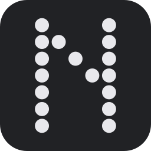
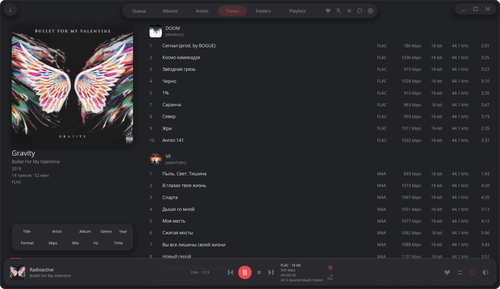
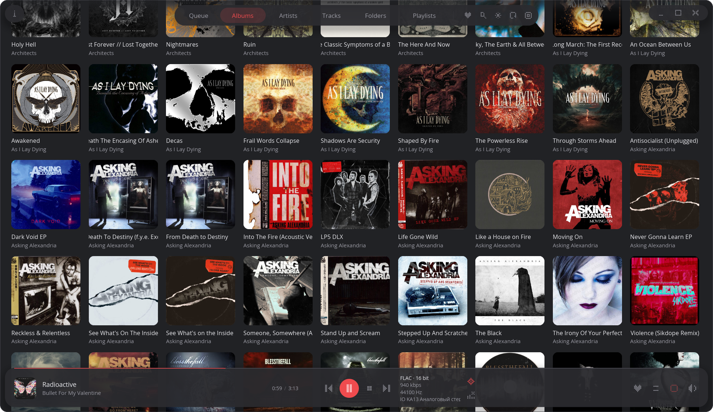
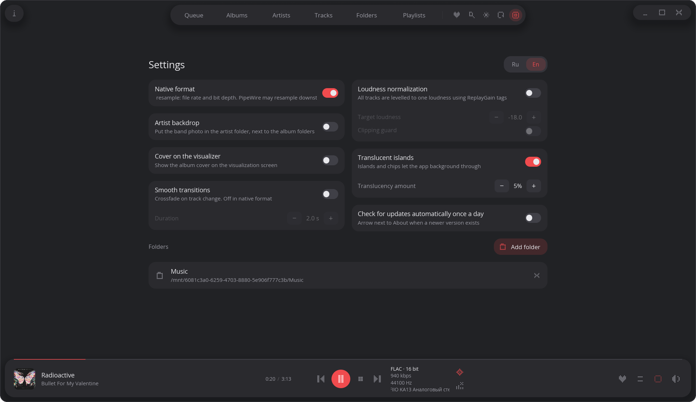
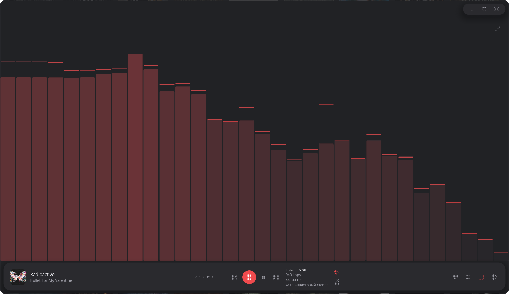
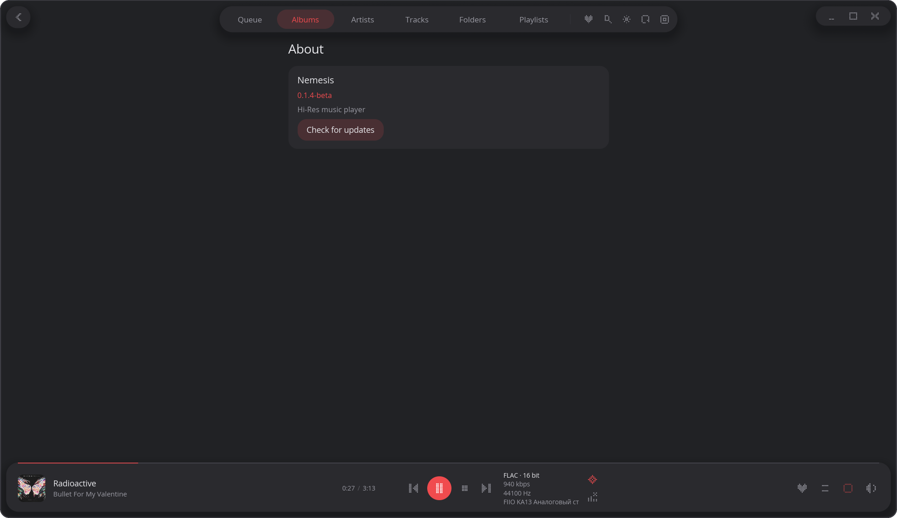
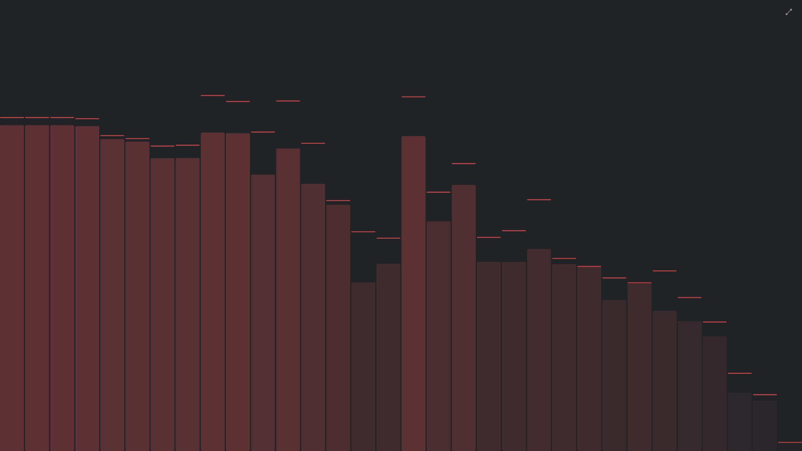

<div align="center">



# Nemesis

Локальный музыкальный плеер. Нативный интерфейс на [iced](https://iced.rs/), без встроенного браузера.<br/>Красивый, быстрый, hi-res PCM, без Electron. Windows и Linux.

<p align="center">
  <a href="https://github.com/aevahonin/Nemesis/releases/latest"></a>
  <a href="https://flathub.org/apps/io.github.aevahonin.Nemesis"></a>
  <a href="https://rust-lang.org"></a>
  <a href="#linux-и-windows"></a>
</p>

[Что умеет](#что-умеет) · [Установка](#установка) · [Список изменений](CHANGELOG_ru.md) · [Issues](https://github.com/aevahonin/Nemesis/issues)

[English](README.md) · **Русский**

</div>

<p align="center">
  
</p>

<details>
<summary>Ещё скриншоты</summary>

<p align="center">
  
  
  
  
  
  
</p>

</details>

---

## Что умеет

**Библиотека и воспроизведение**

- Библиотека на диске: mp3, flac, wav, ogg/Vorbis, opus, m4a/aac, alac, CUE-листы, обложки.
- Страница «Главная»: ряды «Продолжить» и «Часто слушаете», строка статистики и кубик «Случайный альбом».
- Очередь, альбомы, исполнители, треки, папки, плейлисты; shuffle, repeat, кроссфейд, gapless, перемотка, избранное.
- Поиск по названию, исполнителю и альбому: регистр не важен (в том числе в кириллице), лишние пробелы схлопываются, «ё» и «е» считаются одной буквой. Enter играет выдачу начиная с первого результата.
- Плейлисты: создание, добавление треков, сохранение очереди как плейлиста, импорт `m3u8` / `m3u` / `pls` (старые m3u в CP1251 тоже читаются).
- Мини-плеер: большое окно складывается в компактный бар, который тянется из любого места.

**Звук**

- **Нативный формат:** приложение выводит родные частоту и разрядность файла и само не ресемплирует. PipeWire или общий WASAPI могут ресемплировать ниже по цепочке. Плеер показывает реальные разрядность и частоту.
- **Нормализация:** теги ReplayGain с целевой громкостью (−24…−12 LUFS, по умолчанию −18) и переключателем защиты от клиппинга.
- Графический эквалайзер с семью пресетами и преампом (−12…+12 дБ).
- Кроссфейд в обоих режимах вывода, включая нативный формат; бесшовные стыки без щелчков.

**Тексты и исполнители**

- Тексты из локальных `.lrc` и тегов: текущая строка над плеером, полный текст с метками куплетов на странице «Сейчас играет».
- Страница «Сейчас играет»: обложка и волна трека — клик или перетаскивание по волне перематывают.
- С тумблером «Инфо об исполнителе из сети»: биографии из Википедии, «Интересные факты» и «В этот день в мире музыки» на «Главной».

**Интерфейс**

- Полноэкранная визуализация: спектр с «шапочками» пиков, обложка альбома, кнопка на весь экран, автоскрытие курсора.
- Прозрачные «островки» с размытым фоном, безрамочное окно, тёмная и светлая темы, ру/ен.
- Медиа-клавиши без фокуса: MPRIS на Linux, SMTC на Windows.
- Страницы исполнителей открываются на большом постере из папки исполнителя.

Пока нет в этом релизе: эксклюзивный режим, DSD, PEQ.

Данные: Linux `~/.nemesis/`, Windows `%USERPROFILE%\.nemesis\` (библиотека, кэш обложек, окно, настройки).

---

## Linux и Windows

Windows x86_64 smoke: окно, скан, play/next/stop, SMTC, тема.

| | Linux (x86_64) | Windows 10/11 (x86_64) |
|---|---|---|
| Скан, очередь, shuffle, repeat, кроссфейд | да | да |
| Нативный PCM-формат | да | да |
| Громкость в нативном формате | `pactl` (sink-input) | громкость WASAPI-сессии |
| Нормализация ReplayGain, защита от клиппинга | да | да |
| Визуализация (полноэкранный спектр + обложка) | да | да |
| Плейлисты, импорт m3u/m3u8/pls | да | да |
| Медиа-клавиши без фокуса | MPRIS (`nemesis` на D-Bus) | SMTC |
| Тема / акцент системы | portal, GNOME, KDE | реестр |
| Безрамочное, прозрачное окно | да | да |
| Установка | Flathub / `.deb` / `.rpm` / `.pkg.tar.zst` / AppImage / tar.gz | **setup.exe** (текущий пользователь, без прав администратора) или **portable zip** |

---

## Установка

Все пакеты — на [странице релизов](https://github.com/aevahonin/Nemesis/releases/latest). На обычный ПК берите сборку **x86_64**.

### [Flathub](https://flathub.org/apps/io.github.aevahonin.Nemesis) (любой дистрибутив)

```bash
flatpak install flathub io.github.aevahonin.Nemesis
```

### Debian / Ubuntu (12+ / 22.04+)

```bash
sudo dpkg -i nemesis-*-debian-x86_64.deb
sudo apt-get install -f   # если не хватает зависимостей
```

### Fedora (39+)

```bash
sudo dnf install nemesis-*-fedora-x86_64.rpm
```

### Arch / Manjaro / EndeavourOS

```bash
sudo pacman -U nemesis-*-arch-x86_64.pkg.tar.zst
```

В AUR пакета пока нет.

### AppImage

Сделайте `nemesis-*-linux-x86_64.AppImage` исполняемым и запустите.

### Linux без пакета дистрибутива

Распакуйте `nemesis-*-linux-x86_64.tar.gz` в корень `/` (внутри `usr/bin/nemesis` и `.desktop`-файл). Или запустите бинарник из `usr/bin/` на системе с совместимой glibc.

Нужны PipeWire или PulseAudio и драйвер GPU (Vulkan/OpenGL).

### Windows

**Установщик:** `nemesis-*-windows-x86_64-setup.exe` ставится для текущего пользователя, без прав администратора.

**Portable:** распакуйте `nemesis-*-windows-x86_64-portable.zip` и запустите `nemesis.exe`. Дополнительных DLL не нужно. В меню «Пуск» сам не добавляется.

---

## Матрица поддержки

| Сборка | Статус |
|---|---|
| Linux x86_64, glibc ≥ 2.36 (Debian 12, Ubuntu 22.04, Fedora 39+, актуальный Arch) | основная |
| Windows 10/11 x86_64 | основная, установщик или portable |
| Linux aarch64, Windows ARM64 | **экспериментальная** |

Экспериментальные сборки **нигде не запускались**: пакет может не установиться, окно или звук могут не завестись. Для повседневного использования — x86_64.

Не тестировалось (отчёты приветствуются, если попробуете):

- DE / композитор кроме GNOME/KDE
- HiDPI, несколько мониторов, Windows snap
- аппаратные клавиши гарнитуры, SMTC/MPRIS из интерфейса ОС
- большие библиотеки, CUE, нестандартные теги
- нативный формат 24 бита / 96 кГц на конкретном устройстве
- Windows ARM / Linux ARM

---

## Стек

[Rust](https://rust-lang.org), [iced](https://github.com/iced-rs/iced) 0.14, [wgpu](https://github.com/gfx-rs/wgpu), [rodio](https://github.com/rustaudio/rodio), [cpal](https://github.com/RustAudio/cpal), [Symphonia](https://github.com/pdeljanov/symphonia) (flac / alac / mp4 / mp3 / ogg / wav), [libopus](https://github.com/xiph/opus) через audiopus, [Lofty](https://github.com/Serial-ATA/lofty-rs), [rusqlite](https://github.com/rusqlite/rusqlite) (SQLite вшит), [rfd](https://github.com/PolyMeilex/rfd) (диалоги файлов/папок), [souvlaki](https://github.com/sinono3/souvlaki) (медиа-клавиши). Звук: [ALSA](https://github.com/alsa-project/alsa-lib) → [PipeWire](https://github.com/PipeWire/pipewire)/[Pulse](https://github.com/pulseaudio/pulseaudio) на Linux, [WASAPI](https://learn.microsoft.com/en-us/windows/win32/coreaudio/wasapi) на Windows.

---

## Обратная связь

[Issues](https://github.com/aevahonin/Nemesis/issues) этого репозитория.

Пожалуйста, укажите:

1. ОС и версию (например Arch, Ubuntu 24.04, Windows 11 23H2), окружение (GNOME / KDE / другое).
2. Архитектуру: x86_64 или ARM.
3. Точное имя файла релиза (`nemesis_…deb`, zip, …).
4. Версию из «О приложении».
5. Что сделали, что ожидали, что произошло. Для багов интерфейса — скриншот.
6. Включён ли нативный формат, формат проблемного файла (flac 16/44.1 и т.п.).

У Windows-релиза нет консоли — лога cmd не будет. На Linux вставьте вывод терминала, если запускали из терминала.

Не прикладывайте всю библиотеку или `library.db`. Достаточно одного воспроизводящего файла (если можете поделиться) и шагов.
